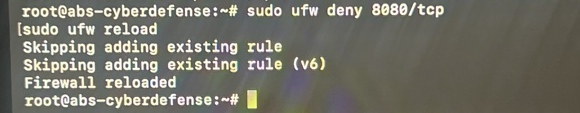
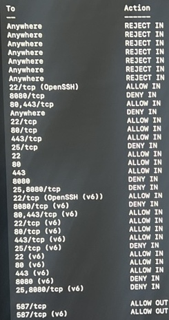
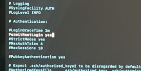
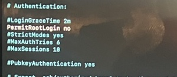

# Linux firewall hardening with UFW

**Lab owner and author · Alejandro B S**

I reviewed the inbound policy on a Linux host to answer a specific question: did the firewall list a deny rule for TCP port 8080 under both IPv4 and IPv6? I also documented a related change to the OpenSSH configuration for direct root login.

## Firewall findings

| Question | Evidence | Finding |
| --- | --- | --- |
| Was the 8080 rule already present? | UFW reported “Skipping adding existing rule” for the rule and its v6 counterpart. | Reissuing the deny command found both existing rules. |
| Did the firewall reload? | The terminal returned “Firewall reloaded”. | UFW acknowledged the reload. |
| Which direction did the rules cover? | The list shows both `8080/tcp` and `8080/tcp (v6)` with `DENY IN`. | The listed rules cover inbound connections to TCP 8080 in both address families. |

The list also shows inbound allow rules for SSH and web traffic and an outbound allow rule for TCP 587. Several entries overlap. For an investigation into a specific connection, I would check the source and rule order, then correlate the attempt with a timestamped firewall log. The photographs establish the configured rules and reload. An end-to-end connection test remains unverified.

## OpenSSH configuration review

The editor captures show the direct root-login setting changing from `PermitRootLogin yes` to `PermitRootLogin no`. This setting addresses who may authenticate over SSH, a separate question from whether the firewall permits connections to port 22.

| Before | After |
| --- | --- |
|  |  |

The SSH evidence covers the edit. Confirming enforcement would require checking the effective configuration and testing a new session after the service loaded the change.

*Evidence consists of crops from the original lab photographs. The firewall list shows only the destination and action columns to keep source IP addresses private.*
